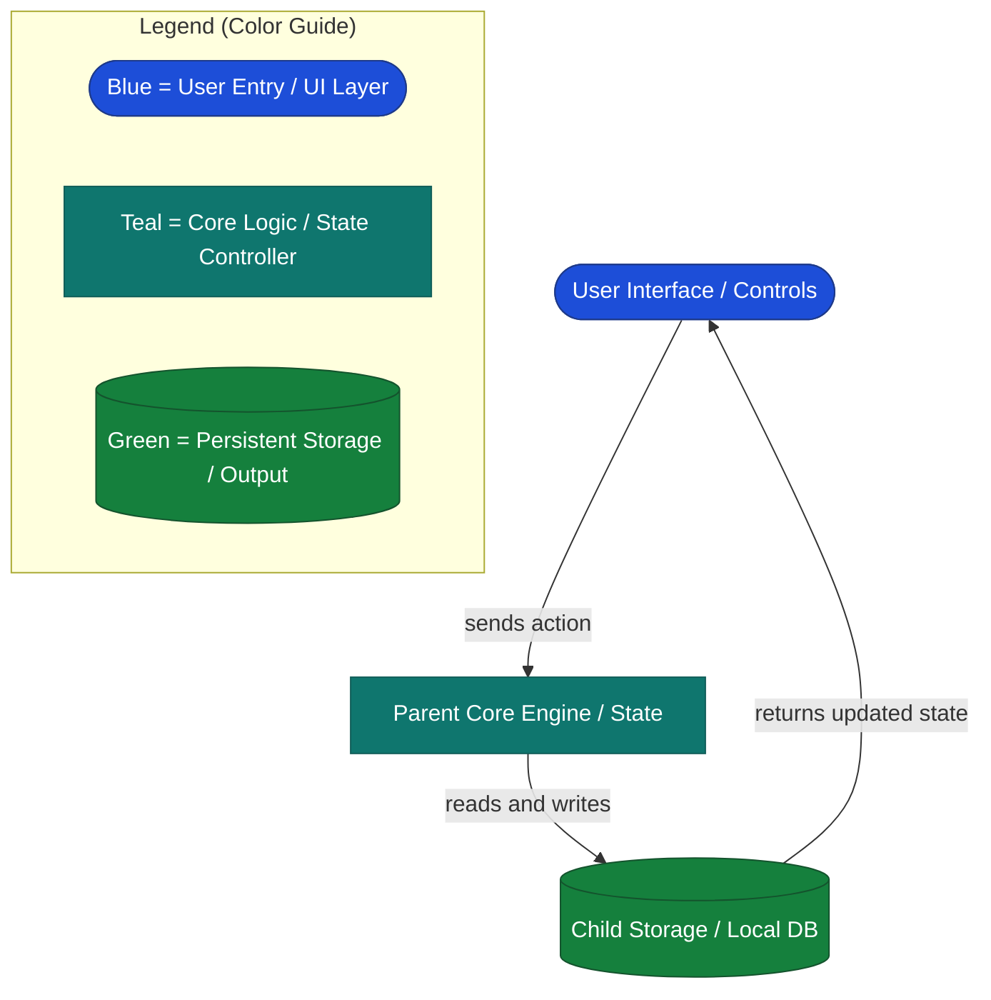
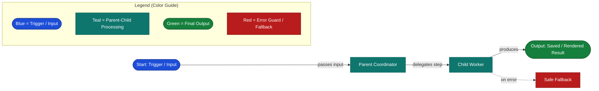

# System Architecture (`ARCHITECTURE.md`)
> **1-Line Summary:** Plain-English visual map of how the app works, why we chose each tool, and step-by-step recipes for adding new features. *(Build, lint, and test commands live in the project's root `AGENTS.md`.)*

## 1. High-Level Visual System Map
* **Plain-English Overview:** [2–3 simple sentences explaining how the user interface, core logic, and storage connect from start to finish.]

## 2. Tech Stack & Why We Chose It

| Layer | Tool / Library | Plain-English Reason Why |
| --- | --- | --- |
| Host / UI | [e.g., Electron + Vue 3] | [1-sentence practical reason] |

## 3. Core Subsystems & Engineering Tricks

### [SUBSYSTEM: Descriptive-Mechanism-Name] | Aliases: keywords, component names
> **1-Line Summary:** [How this part of the program works in plain English.]
* **How It Works (Plain English):** [Clear explanation without jargon — where the flow begins, how parent and child parts interact, and what output is produced.]
* **Data Flow Diagram:**

* **Code Anchors (Grep Targets):**
  * `src/path/file.ts` -> `functionOrClassName`

## 4. Recipes: How to Add New Things Safely
* **To add a new [Feature/Step/Template]:**
  1. Edit `fileA` -> `arrayOrFunction`
  2. Register in `fileB` -> `handlerName`
