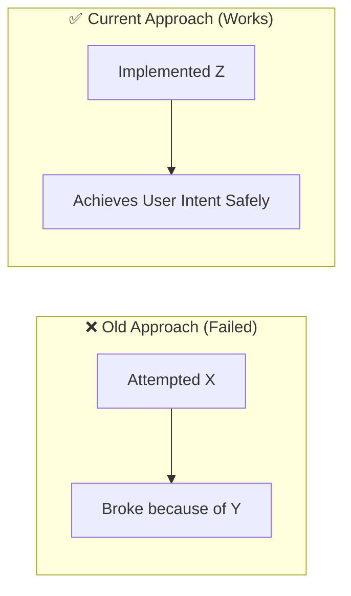

# Architectural Decisions, Pivots & Landmines (`DECISIONS_AND_TRAPS.md`)
> **1-Line Summary:** Records why we chose specific approaches, what failed when we tried other ways, who made the decision, and critical code traps never to touch.

## 1. Architectural Decisions & Pivot History

### [DECISION: Descriptive-Choice-Name] | Aliases: feature name, alternative rejected, keywords
> **1-Line Summary:** [What we decided to do and what failed approach it replaced.]
* **Decision Maker:** `[DECIDED BY: HUMAN]` (or `[DECIDED BY: AGENT - Approved by Human]`)
* **Original User Intention:** [What the user wanted to achieve]
* **Options Considered:**
  * **Option A (Rejected):** [What it was and why it failed or was rejected]
  * **Option B (Chosen):** [What we implemented and why it works]
* **Visual Pivot Map (What Failed vs. What Works):**

* **Code Anchors (Grep Targets):**
* `src/path/file.ts` -> `implementedFunctionName`

---

## 2. Do-Not-Touch Engineering Landmines (Traps)

### [TRAP: Descriptive-Trap-Name] | Aliases: bug symptom, broken behavior, file name

> **1-Line Summary:** [Strict rule on what NOT to change, and what breaks if you do.]

* **Strict Rule:** **NEVER** [state exact action to avoid, e.g., move script X into index.html].
* **Why This Trap Exists (Plain English):** [Explain the hidden interaction, e.g., Electron resets plugin arrays during async startup, or Windows OS dark mode inverts SVG CSS light-dark() colors.]
* **Protected Code Anchors (Grep Targets):**
* `src/path/file.ts` -> `protectedFunctionOrGuardName`

