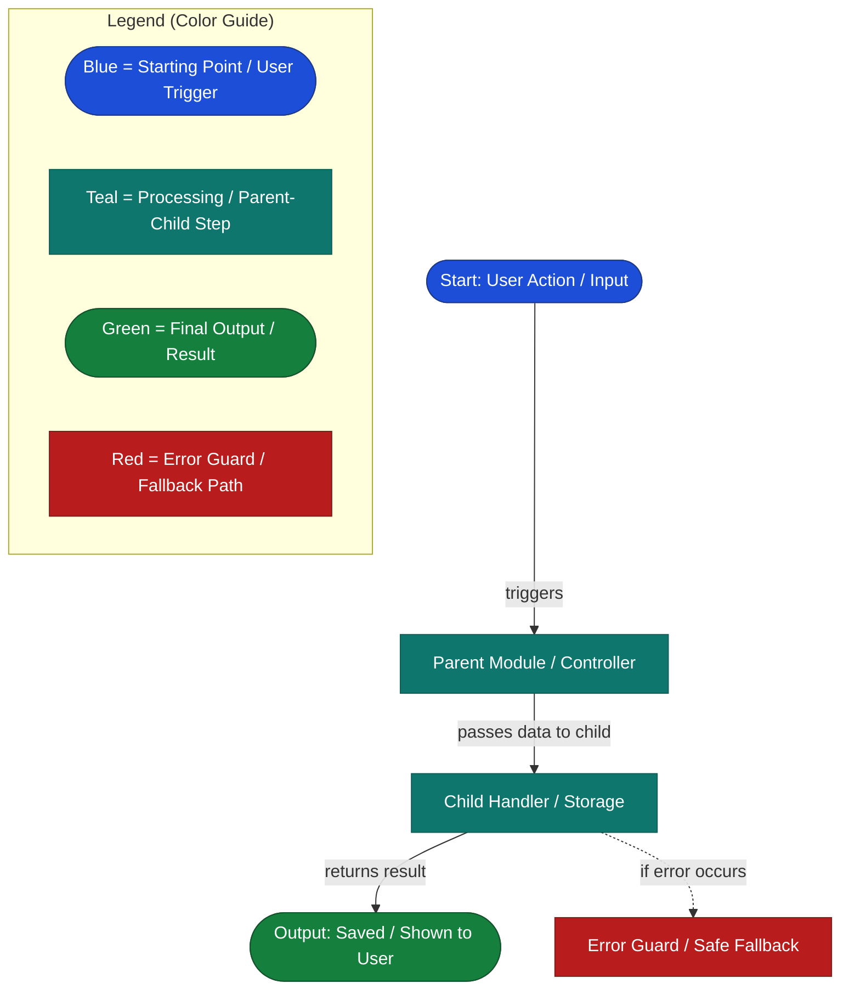

# Visual Feature & Change Log (`VISUAL_LOG.md`)
> **1-Line Summary:** Plain-English, color-coded Obsidian-compatible Mermaid flowcharts explaining how each new feature or significant change works end to end.

## Feature & Change Flowcharts

### [VISUAL: Descriptive-Feature-Or-Change-Name] | Aliases: feature name, commit topic, keywords
> **1-Line Summary:** [What this feature/change does from start to finish in one simple sentence.]

* **Plain-English Walkthrough:** [Explain in 2–3 simple, jargon-free sentences where the flow begins, how parent and child steps interact, and what output the user sees.]

* **Code Anchors (Grep Targets):**
  * `src/path/file.ts` -> `entryFunctionName`, `childHandlerName`
