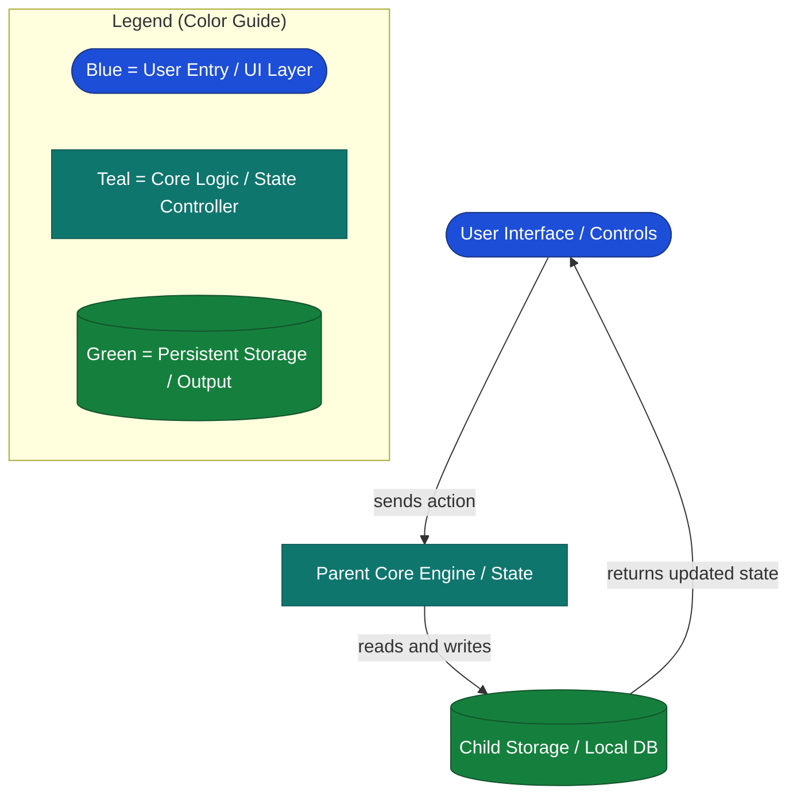
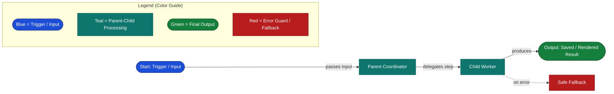

# System Architecture & Visual Flows (`ARCHITECTURE.md`)
> **1-Line Summary:** Single living visual map of how the app works, why we chose each tool, canonical implementation code anchors, color-coded feature/subsystem flowcharts, and safe extension recipes. *(Build and test commands live in root `AGENTS.md`.)*

## 1. High-Level Visual System Map
* **Plain-English Overview:** [2–3 simple sentences explaining how the user interface, core logic, and storage connect from start to finish.]

## 2. Tech Stack & Why We Chose It

| Layer | Tool / Library | Plain-English Reason Why |
| :--- | :--- | :--- |
| Host / UI | [e.g., Electron + Vue 3] | [1-sentence practical reason] |

## 3. Core Subsystems & Visual Feature Flows
*(Update diagrams here in place whenever a subsystem or feature flow changes—no separate visual changelog needed.)*

### [SUBSYSTEM: Descriptive-Mechanism-Name] | Aliases: keywords, component names
> **1-Line Summary:** [How this subsystem works from start to finish in plain English.]
* **Links:** `[FEATURE: Descriptive-Feature-Name]`, `[TRAP: Descriptive-Trap-Name]`
* **Plain-English Walkthrough:** [2–3 simple, jargon-free sentences explaining where the flow begins, how parent and child parts interact, and what output the user sees.]

* **Code Anchors:**
  * `src/path/file.ts :: functionOrClassName`

### [FLOW: Descriptive-Feature-Flow-Name] | Aliases: feature name, user action, keywords
> **1-Line Summary:** [What this end-to-end feature flow does from user trigger to final output in one sentence.]
* **Links:** `[FEATURE: Descriptive-Feature-Name]`, `[DECISION: Descriptive-Choice-Name]`, `[TRAP: Descriptive-Trap-Name]`
* **Plain-English Walkthrough:** [Explain where the user action starts, what intermediate steps run, and how errors are handled.]
* **Code Anchors:**
  * `src/path/file.ts :: entryFunctionName`
  * `src/path/file.ts :: childHandlerName`

## 4. Recipes: How to Add New Things Safely
* **To add a new [Feature/Step/Template]:**
  1. Edit `src/path/fileA.ts :: registryOrFactory`
  2. Wire handler in `src/path/fileB.ts :: handlerName` and add test coverage in `PRODUCT.md` (`Verified By:`)
