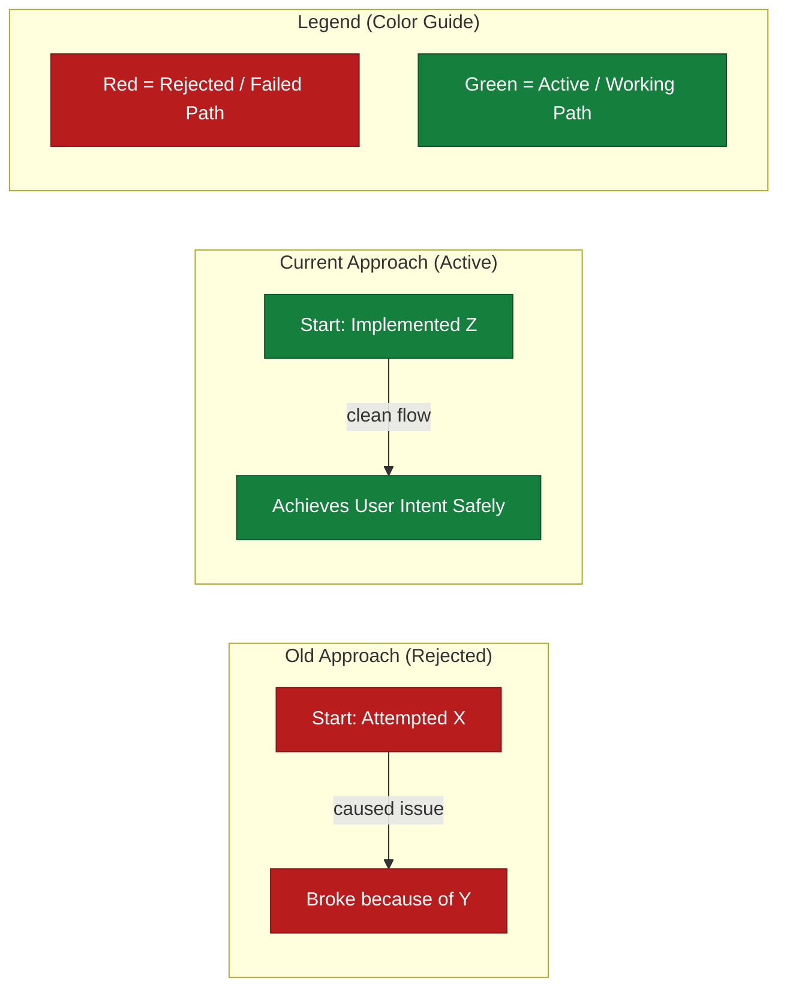

# Architectural Decisions, Waivers & Landmines (`DECISIONS_AND_TRAPS.md`)
> **1-Line Summary:** Records architectural pivots, intentional audit/UI waivers, who made each choice, and critical engineering traps never to touch. *(Keep 1-line `[TRAP: <Slug>]` pointers in root `AGENTS.md` and implementation anchors in `docs/ARCHITECTURE.md`.)*

## 1. Architectural Decisions, Pivots & Audit Waivers

### [DECISION: Descriptive-Choice-Name] | Aliases: feature name, rejected alternative, waiver keywords
> **1-Line Summary:** [What we decided (or intentionally waived) and what failed or rejected approach it replaced.]
* **Links:** `[FEATURE: Descriptive-Feature-Name]`, `[FLOW: Descriptive-Feature-Flow-Name]`
* **Decision Maker:** `[DECIDED BY: HUMAN]` *(or `[DECIDED BY: AGENT - Approved by Human]`)*
* **Options Considered:**
  * **Rejected / Waived:** [Failed path, rejected OSS library, or waived UI surface (`N/A — Cumbersome` / `N/A — Conflicting`) and why]
  * **Chosen:** [Active architecture or lean surface kept, and why it works safely]
* **Visual Pivot Map (Include for Architectural Flow Pivots):**

---

## 2. Do-Not-Touch Engineering Landmines (Traps)

### [TRAP: Descriptive-Trap-Name] | Aliases: bug symptom, broken behavior, file name
> **1-Line Summary:** [Strict rule on what NOT to change, and what breaks if you do.]
* **Links:** `[SUBSYSTEM: Descriptive-Mechanism-Name]`, `[FLOW: Descriptive-Feature-Flow-Name]`
* **Strict Rule:** **NEVER** [state exact action to avoid, e.g., bind server to `0.0.0.0` or skip atomic temp-file writes].
* **Why This Trap Exists (Plain English):** [Explain the hidden OS, framework, or concurrency interaction discovered during development or an audit.]
* **Protected Code Anchors:**
  * `src/path/file.ts :: protectedFunctionOrGuardName`
